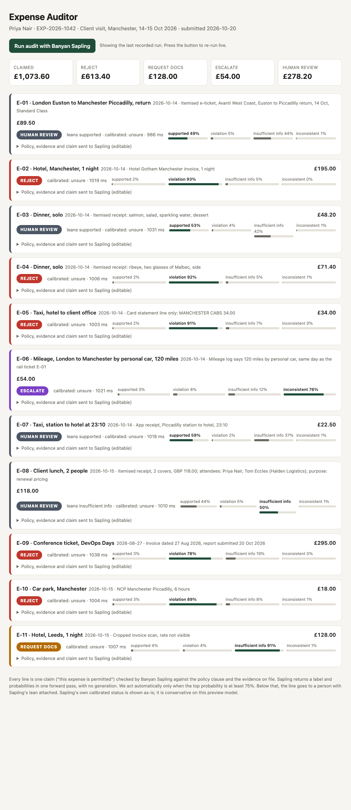

# Expense Auditor, powered by Banyan Sapling

Every line of an expense report is a claim: "this expense is permitted." Banyan Sapling checks each claim against the policy clause and the evidence on file (receipts, logs, dates) and returns one of four verdicts in a single forward pass:

| Sapling label | What the auditor does | Example in the demo |
|---|---|---|
| `supported` | Approve | Standard Class rail ticket |
| `violation` | Reject | GBP 195 hotel against a GBP 130 cap; wine on a dinner bill; claim 54 days late |
| `insufficient_information` | Request documents | Hotel invoice scan with the rate cropped out |
| `inconsistent_context` | Escalate | Mileage claimed for a drive on the same day as a paid train ticket for the same journey |

Sapling does the judging. The surrounding code only splits the report into claims and routes on the result.



## Run it

```bash
python3 server.py        # http://localhost:8000, Python 3 stdlib only, no keys
python3 audit.py         # CLI: audits data/report.json and writes data/results.json
```

Press **Run audit** to send all 11 lines to the live endpoint in parallel and watch verdicts arrive (about 1 s each). Open "Policy, evidence and claim" on any card to edit the text and re-check that line. If no backend is reachable, the page falls back to the recorded run in `web/results.json`, so `web/` also works as a static site.

## How triage works (and why)

Sapling's calibrated `status` came back `unsure` on every line here. The model card says shared calibration answers about 45% of cases and that this is a research preview. So the auditor:

- acts automatically only when the raw label's probability is at least 0.75
- otherwise sends the line to **HUMAN REVIEW** with Sapling's lean and probabilities attached
- shows the calibrated status on every card instead of hiding it

## Honest results on the sample report (verbatim, see `data/results.json`)

- 6 of 11 lines were acted on automatically, all as intended: 4 rejects (0.78 to 0.93), 1 escalation (0.76), 1 document request (0.91).
- The 4 lines sent to human review are the ones where Sapling was near 50/50. Three are genuinely compliant lines it leaned `supported` on (0.49 to 0.59), and one is a compliant client lunch where it leaned `insufficient_information` (0.50). It never approved anything automatically, which is the conservative failure mode you want here.
- The parking line (policy silent) was rejected as `violation` (0.89), not `insufficient_information`. Whether silence means "no" is a policy choice the model made for us.
- The report is synthetic. The policy, evidence and claim wording was tightened over a few iterations to fit the model's short controlled-scenario sweet spot. A first pass with long multi-clause policies returned `unsure` everywhere. The inputs shipped are in `data/report.json`.

## Files

- `sapling.py`: endpoint client and triage rule
- `audit.py`: CLI batch audit
- `server.py`: static server plus `/api/verify` proxy (avoids browser CORS)
- `web/index.html`: UI
- `data/report.json`, `data/results.json`: sample report and recorded run
